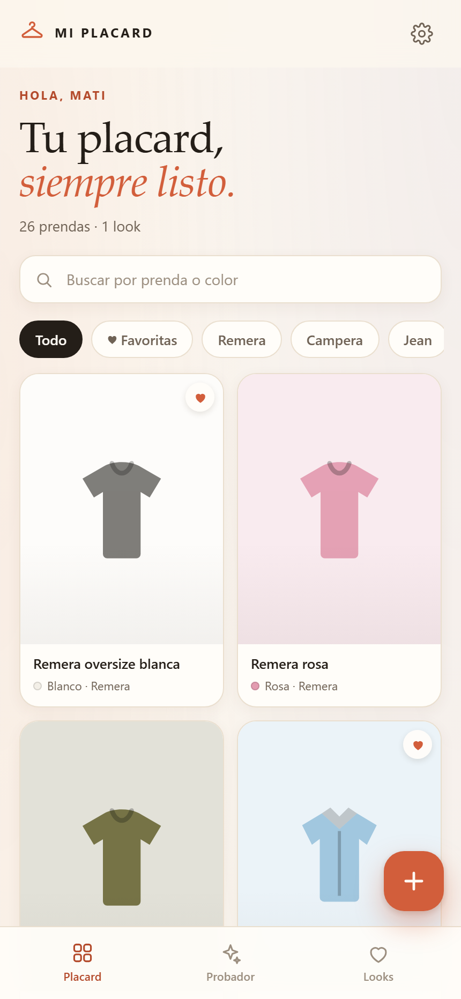
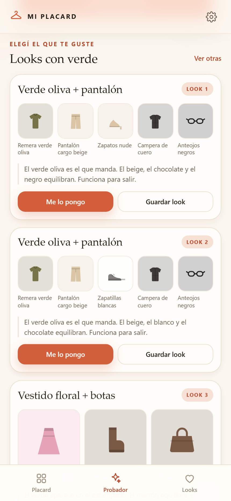

# Mi Placard · la app de Mati

Web app instalable (PWA) para cargar el guardarropa, verlo clasificado y pedirle a la app que arme un look con lo que ya hay.

## Ya está publicada

**<https://wlacaze-git.github.io/mi-placard/>**

Abrí ese link en el celular, agregala a la pantalla de inicio y listo. Funciona sin conexión después de la primera visita.

- **Android**: menú ⋮ → *Instalar app* (o *Agregar a pantalla de inicio*).
- **iPhone**: botón Compartir → *Agregar a pantalla de inicio*.

El código publicado vive en <https://github.com/wlacaze-git/mi-placard> (GitHub Pages, HTTPS, gratis).

No necesita cuentas ni servidores: **las fotos y los datos se guardan solo en el dispositivo**.



## Qué puede hacer

- **Cargar prendas con foto**: la imagen se recorta y comprime sola, y la app detecta los colores de la foto. Después se elige categoría, color, temporada, ocasión y notas.
- **Reconocer la categoría sola**: un modelo de visión (ConvNeXt) corre en el celular y propone la categoría (remera, jean, zapatillas, vestido…). Se puede corregir con un toque. La primera vez baja unos 30 MB y después queda guardado; se puede desactivar en Ajustes.
- **Ver el placard ordenado**: agrupado por categoría, con búsqueda por nombre o color, filtros por categoría y favoritas.
- **Pedir un look como se habla**: “quiero usar algo verde para salir”, “un jean para la facu”, “hace frío”, “algo cómodo”…
- **Tres combinaciones completas** (arriba, abajo, calzado y, si hace falta, abrigo o accesorio) con una explicación de por qué combinan y un botón **“Ver otras”** para cambiar la propuesta.
- **Guardar looks** y registrar **“Me lo pongo”**, que suma el uso de cada prenda para no repetir tanto.
- **Armar un look a partir de una prenda**: desde la ficha de cualquier prenda, “Armar un look con esta prenda”.
- **Funciona sin internet** después de la primera visita.
- **Backup** para exportar/importar todo (prendas, fotos y looks) desde Ajustes.



## Probarla en la compu

Desde la carpeta del proyecto:

```bash
node tools/serve.mjs 4180
```

Y abrir <http://127.0.0.1:4180>.

> Tiene que ser por `http://` o `https://`: si se abre con doble clic (`file://`), la app funciona pero no se puede instalar ni guardar para uso sin conexión.

Para probar sin cargar nada, tocar **“Probar con un placard de ejemplo”** (26 prendas y un look).

## Actualizar la versión publicada

La app publicada es la carpeta `dist`. Después de un cambio:

1. Regenerar `dist` con los archivos de la app.
2. Copiar el contenido a la carpeta de publicación y hacer commit/push al repo.
3. GitHub Pages reconstruye solo en menos de un minuto.

> Si se cambia `sw.js`, conviene subir el número de `VERSION` (por ejemplo `mi-placard-v3`) para que los celulares que ya la instalaron bajen la versión nueva.

## Privacidad y backups

- Cada dispositivo tiene su propia base local (IndexedDB). Nada se sube a internet.
- El modelo de reconocimiento se descarga una vez y corre **en el celular**; la foto no se envía a ningún servidor.
- Si se borran los datos del navegador o se cambia de celular, se restaura desde **Ajustes → Exportar backup** / **Importar backup** (archivo `.json` con las fotos incluidas).
- Si se instala desde un dominio distinto, es otra base: conviene empezar directamente con la URL definitiva.

## Estructura

```
index.html               pantalla única (3 secciones + alta + hojas modales)
styles.css               diseño mobile-first
js/catalog.js            categorías, temporadas, ocasiones, colores e íconos SVG
js/colors.js             conversiones de color, nombres en castellano, paleta desde foto, armonía
js/db.js                 IndexedDB (prendas, looks, meta)
js/photo.js              reducción y compresión de fotos
js/vision.js             reconocimiento de categoría con IA en el dispositivo
js/sample.js             placard de ejemplo
js/recommend.js          lectura del pedido + armado y puntaje de looks
js/app.js                estado, render y eventos de la interfaz
manifest.webmanifest     configuración PWA
sw.js                    service worker (offline)
icons/                   íconos generados
tools/                   servidor local, capturas/pruebas de UI, generadores
test/logic.mjs           pruebas de lógica
```

## Pruebas

```bash
node test/logic.mjs     # 23 pruebas: catálogo, colores, interpretación y armado de looks
node tools/shoot.mjs    # 48 verificaciones de UI + capturas en shots/ (requiere Chrome y el server en 4180)
```

Las capturas de `shots/` se generan automáticamente con Chrome headless.

## Cómo está pensado el recomendador

1. **Interpreta el pedido**: detecta colores (“verde”, “azul marino”, “oliva”), prendas (“jean”, “zapatillas”), ocasión (“salir”, “facu”, “trabajo”) y clima (“frío”, “calor”).
2. **Elige una prenda protagonista** que cumpla el pedido. Si el color aparece solo en un estampado, también lo tiene en cuenta y lo aclara.
3. **Completa el look** con las otras capas (arriba/abajo/calzado/abrigo/accesorio), priorizando armonía de color, ocasión, abrigo, favoritas y variedad.
4. **Puntúa y elige 3 combinaciones distintas**, con una explicación en castellano de por qué funcionan.

La armonía de color usa reglas de teoría del color (neutros, análogos, complementarios y contraste de claro/oscuro), no una API externa.
